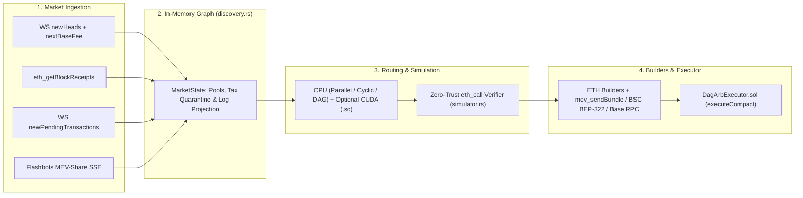
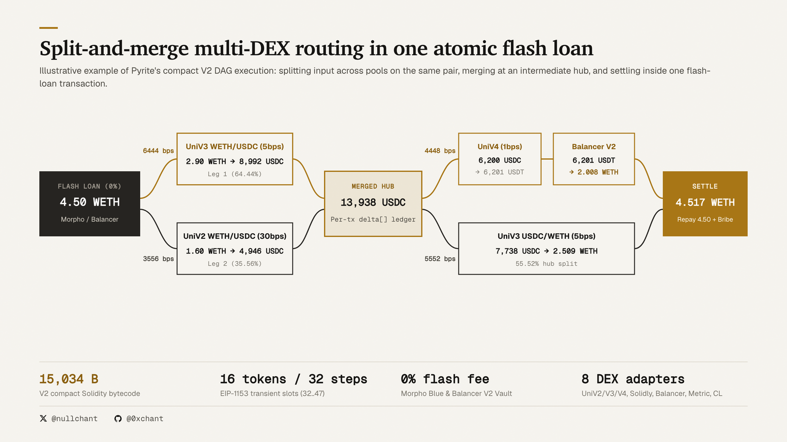
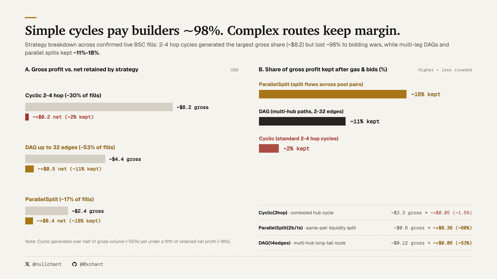
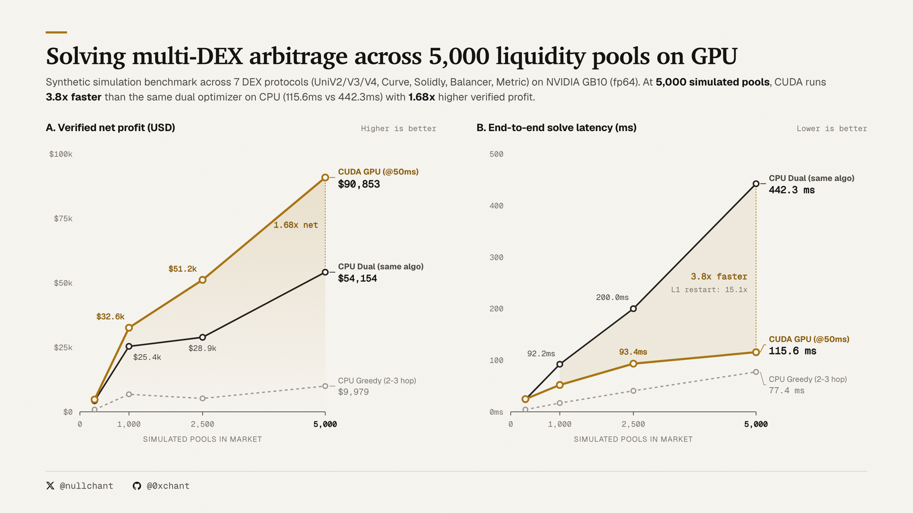

# Pyrite

[](https://github.com/0xchant/pyrite/actions/workflows/ci.yml)
[](./LICENSE)
[](#how-it-works)
[](./contracts/src/DagArbExecutor.sol)
[](./cuda/README.md)

Pyrite is an experimental multi-chain EVM atomic arbitrage engine written in Rust, Solidity, and optional CUDA. It combines multi-DEX split-merge graph routing, `eth_call` state-override simulation, MEV-Boost / BEP-322 bundle submission, Flashbots MEV-Share SSE backruns, and a stdlib Python web control terminal.

[Quick start](#quick-start)
| [How it works](#how-it-works)
| [Protocols and layout](#protocol-coverage-and-repository-layout)
| [CUDA solver](#optional-cuda-solver)
| [Benchmarks](#benchmarks-and-mainnet-results)
| [Configuration](#configuration)
| [Limitations](#known-limitations)
| [Postmortems](./docs/pitfalls/README.md)

> [!CAUTION]
> The Rust engine, Solidity contracts, scripts, and documentation in this repository were written and maintained primarily with AI assistance under human direction. None of the code has undergone an independent security audit, and the project is published as an open research reference, without profitability guarantees. Default to `scan` or `--dry-run` with minimal burner gas balances if experimenting, inspect the code yourself, and assume all financial and technical risk.

## Quick start

### Prerequisites

- Rust (`stable` toolchain via `rustup`)
- Foundry (`forge`, `cast`, `anvil`)
- Python 3.10+ (standard library only for `scripts/dashboard.py` and `cuda/bench.py`)
- Optional: NVIDIA CUDA Toolkit (`nvcc`) when compiling `cuda/`

### 30-second offline demo

Build the contracts and Rust binary, replay anonymized mainnet opportunities, and open the Web Control Terminal locally with zero API keys, RPCs, or gas:

```bash
git clone https://github.com/0xchant/pyrite
cd pyrite

# 1. Build Solidity executor bytecode artifacts and run Foundry tests
cd contracts && forge build && forge test --match-path test/DagArbExecutor.t.sol && cd ..

# 2. Run Rust unit tests and build the release binary
cargo test --release && cargo build --release

# 3. Replay offline opportunities and compare bidding profiles
./target/release/pyrite backtest --opps-file examples/sample_opps.jsonl --min-profit-usd 0.001

# 4. Launch the Web Control Terminal against sample telemetry
python3 scripts/dashboard.py --logs-dir examples/sample_logs --chain eth --web
```

### Live scan and dry-run

```bash
# Read-only live block scan with eth_call bytecode state-override verification
./target/release/pyrite scan --chain eth --blocks 10 --min-profit-usd 0.01

# Full runtime loop using pyrite.json (dry_run skips signing and broadcasting)
./target/release/pyrite run --config pyrite.json --dry-run

# Historical block A/B pruning benchmark
./target/release/pyrite backtest --chain eth --blocks 20 --ab-pruning
```

## How it works

Pyrite ingests new block headers, block receipts (`eth_getBlockReceipts`), pending mempool transactions, and Flashbots MEV-Share SSE hints into an in-memory liquidity graph (`src/discovery.rs`). Candidate routes are generated by three CPU routers plus an optional CUDA library, verified against live EVM state via `eth_call` `stateOverrides` (`src/simulator.rs`), and submitted to block builders for atomic settlement inside `DagArbExecutor.sol`. See [docs/architecture.md](./docs/architecture.md) for the full algorithm and latency breakdown.



### Routing and on-chain execution

Three Rust routers feed one ranking, step-coalescing, and exact `U256` replay pipeline (`src/router/mod.rs`):

- `parallel.rs` splits input across multiple pools on the same token pair.
- `cyclic.rs` finds 2-4 hop cycles via Meet-in-the-Middle and sizes trade inputs with 24 golden-section iterations.
- `dag.rs` orders intermediate tokens with Feedback Arc Set heuristics and distributes flow across up to 8 directed pool edges (up to `MAX_DAG_STEPS = 32` after coalescing or GPU solving).

<p align="center">
  
</p>

On 450ms BNB Chain blocks (`bundle_span_blocks = 6`), `src/executor.rs` rotates authorized worker keys through an `EoaPool` to avoid single-EOA nonce lockouts, signs builder-specific `bribeRecipient` payloads, and detaches slow HTTP futures once at least two distinct builder backends acknowledge.

`contracts/src/DagArbExecutor.sol` compiles to `15,034 B` under Solidity `0.8.26` (`via_ir=true`, Cancun EVM, Solady `SafeTransferLib`). It packs token indices into one byte `(inIdx << 4) | outIdx`, isolates per-call token accounting in a `uint256[16]` delta ledger backed by EIP-1153 transient slots (`32..47`), sources `0%`-fee flash liquidity from Morpho Blue or Balancer V2 (`1 bps` fallback on UniV3/PancakeV3 or inline UniV2 swaps), and pays `block.coinbase` bribes from contract native reserves without WETH unwraps. Production bytecode uses bare `revert()`; when an `eth_call` simulation fails within diagnostic budget, `src/simulator.rs` overrides the executor address with `DagArbDiagExecutor` to decode `DiagFlashRepayShortfall` (with measured `maxTaxPpm`), `DiagStepZeroReceived`, and `DiagStepSwapReverted` off-chain at zero mainnet gas.

## Protocol coverage and repository layout

Supported AMM pricing and calldata adapters cover `UniV2`, `Solidly` (volatile and stable), `UniV3`, `PancakeV3`, `InfinityCL`, `UniV4`, `BalancerV2` (`Weighted` and `ComposableStable`), and `MetricOmm` (`extsload`).

| Chain | Config template | Execution mode | Revert exposure |
| :--- | :--- | :--- | :--- |
| Ethereum | [chains/eth.yaml](./chains/eth.yaml) | EIP-1559 + 9 MEV-Boost builders + Flashbots MEV-Share | Builder-dropped (`$0` revert gas) |
| BNB Chain | [chains/bsc.yaml](./chains/bsc.yaml) | Legacy gas + BEP-322 builders + WSS pending backrun | Unbundled public txs pay gas |
| Base | [chains/base.yaml](./chains/base.yaml) | EIP-1559 + OP Stack L1 Fee Oracle + public RPC | Reverts pay L2 + L1 data gas |

| Component | Path | Responsibility |
| :--- | :--- | :--- |
| Searcher runtime | [src/](./src/) | State ingestion, graph routing, `eth_call` verifier, EIP-1559/BEP-322 bidding, MEV-Share SSE |
| Compact executor | [contracts/src/DagArbExecutor.sol](./contracts/src/DagArbExecutor.sol) | Bit-packed `executeCompact`, EIP-1153 `delta[]` accounting, Morpho/Balancer flash loans |
| CUDA CFMM solver | [cuda/](./cuda/) | Optional `libcfmm_gpu.so` (`SOLVER_MODE=cpu\|gpu\|hybrid`) loaded dynamically at runtime |
| Web Control Terminal | [scripts/dashboard.py](./scripts/dashboard.py) | Stdlib HTTP/SSE monitor (EN/ZH UI), `pyrite.json` editor, write-only `.env` wallet setup |
| Chain configs | [chains/](./chains/) | RPC endpoints, singletons, hub tokens, factories, and flash-loan seeds |
| Offline dataset | [examples/](./examples/) | Anonymized opportunities and sample telemetry logs for local replay |
| Architecture audit | [docs/architecture.md](./docs/architecture.md) | Router complexity, latency breakdown, and code-level design notes |
| Engineering postmortems | [docs/pitfalls/README.md](./docs/pitfalls/README.md) | 27 production bugs and mainnet economic measurements across ETH, BSC, and L2s |

## Optional CUDA solver

`cargo build` and `cargo test` require no CUDA toolkit or NVIDIA drivers. When `SOLVER_MODE` is set to `gpu` or `hybrid`, `src/router/gpu.rs` loads `libcfmm_gpu.so` lazily via `libloading` and falls back to CPU routing if the shared library is missing. The CUDA pipeline solves the continuous convex CFMM dual in IEEE-754 `fp64` (Stage 1), then applies discrete leg pruning and parallel basin polish (Stage 2) so fixed per-swap gas costs (`52k-135k` gas/hop) do not wipe out fragmented multi-edge routes. Build instructions, parity checks, and `cfmm_update_dirty_pools` microbenchmarks (`0.0006ms` for 50 mutated pools) are documented in [cuda/README.md](./cuda/README.md).

## Benchmarks and mainnet results

Live on-chain runs, live `eth_call` shadow benchmarks, synthetic scaling tests, and local CI suites are separated by scope below. Full methodology, transaction breakdowns, and 27 bug postmortems are recorded in [docs/pitfalls/README.md](./docs/pitfalls/README.md).

| Scope | Workload | Measured result | Context |
| :--- | :--- | :--- | :--- |
| Live on-chain (BSC) | Multi-day live run | `~100` consecutive fills after Day-1 reverts; `~+$1.0` net | `~$15` gross; `~$14` (`~93%`) paid to gas & BEP-322 bids |
| Live on-chain (ETH) | ~21h run (`~4,900` active pools) | `~1,500` bundles sent (`100%` accepted in relay check); `0` fills | `~700-1,000` SSE ev/min, `$0` revert loss; outbid by `110k-140k gas` bots |
| Live `eth_call` (ETH) | ~2.6h `SOLVER_MODE=hybrid` (DGX Spark GB10) | `~$13.5` verified net across `53` blocks (`+27%` vs CPU `~$10.6`) | `19` GPU-only blocks, `18` CPU-only, `16` shared (`GPU` won `12 / 16`) |
| Live `eth_call` (ETH) | CPU graph solve (`solve_us`) | `8-12ms` (`3,300+` pools) / `28-38ms` (`~4,900` pools) | Calm `105-149` pool subgraphs solve in `0.03-0.12ms` on CPU |
| Synthetic (`cuda/bench.py`) | `5,000` simulated 7-protocol pools | GPU `$90,853` in `115.6ms` vs CPU Dual `$54,154` in `442.3ms` | `3.8x` faster; Stage 2 prunes `2,068` dual legs (`-$1.62M`) to `103` (`max_deficit = 0.0`) |
| L2 audit (Orbit `4663`) | `2,000` pure-FCFS `105ms` blocks | `~$32/day` closed-loop arb (`~$0.01` median) vs `~$53k/day` naive scan | Raw `Transfer` audit filtered `xAERO` reward mints and LP NFT rebalances (`1,600x` drop) |
| Local CI suite | Foundry + Cargo + Python unittest | `19` Solidity + `62` Rust (`0.07s`) + `9` Python tests pass | Release profile, `0` compiler warnings |

On BNB Chain, strategy structure determined how much gross margin survived builder auctions: plain 2-4 hop `Cyclic` routes (`~$8.2` gross) lost `~98%` to bidding wars (`~2%` retained), multi-hub `DAG` routes up to 32 edges (`~$4.4` gross) kept `~11%`, and `ParallelSplit` (`~$2.4` gross) kept `~18%`. On Ethereum mainnet, general flash-loan execution (`220k-300k+ gas`) could not beat pre-funded 2-hop Huff/Yul inventory contracts (`110k-140k gas`) in `98%-99.5%` builder margin auctions.

<p align="center">
  
  
</p>

## Configuration

Pyrite keeps shareable runtime parameters in `pyrite.json` and wallet secrets in `.env`:

```bash
cp pyrite.example.json pyrite.json
```

Edit `pyrite.json` directly or through the Config & Control tab in `scripts/dashboard.py` to configure the chain (`eth`, `bsc`, or `base`), `dry_run`, `min_profit_usd`, `target_usd`, HTTP/WS/Bundle RPC endpoints, MEV-Share toggles, CUDA solver mode, and executor contract addresses. CLI flags and `.env` variables override `pyrite.json` (`--config <path>` and `$PYRITE_CONFIG` are supported).

Both the Rust binary and `scripts/dashboard.py` reject private keys stored inside `pyrite.json`. Running `python3 scripts/dashboard.py --logs-dir logs --chain eth --web` prints a one-time `http://127.0.0.1:8080/?token=...` URL protected by `X-Pyrite-Token`; the loopback-only Wallet (Write-Only) tab writes generated or imported keys to `chmod 0600 .env` without exposing them over HTTP GET, or keys can be initialized via `./target/release/pyrite init-wallet --chain eth`.

## Known limitations

Open bottlenecks documented in [docs/architecture.md](./docs/architecture.md) and [docs/pitfalls/README.md](./docs/pitfalls/README.md):

- `src/amm.rs` bounds UniV3 quotes to the active-tick liquidity window and does not yet traverse multi-tick bitmaps.
- CPU `dag.rs` allocates flow using fixed USD tranches; continuous convex sizing currently requires the optional CUDA solver.
- Public Ethereum 2-hop auctions require a dedicated pre-funded assembly executor (`110k-140k gas`) to compete with specialized searchers.
- `src/rpc.rs` caps `eth_call` simulations at `2.4M` gas and does not yet backfill skipped receipt ranges `(last_seen_block + 1)..=bn` on HTTP poll gaps.
- Compact header bit-packing caps unique tokens per route at `16` even when step count scales to `MAX_DAG_STEPS = 32`.

## Documentation

- Mainnet postmortems (27 production bugs and economic analyses): [docs/pitfalls/README.md](./docs/pitfalls/README.md)
- Algorithm and architecture audit: [docs/architecture.md](./docs/architecture.md)
- CUDA CFMM solver and synthetic benchmark guide: [cuda/README.md](./cuda/README.md)
- Security policy: [SECURITY.md](./SECURITY.md)
- Contributing guide: [CONTRIBUTING.md](./CONTRIBUTING.md)

## Acknowledgements

- [alloy](https://github.com/alloy-rs/alloy)
- [Foundry](https://github.com/foundry-rs/foundry)
- [Solady](https://github.com/Vectorized/solady)
- [Flashbots MEV-Share](https://docs.flashbots.net/flashbots-mev-share/overview)

## License

Licensed under the [MIT License](./LICENSE).
