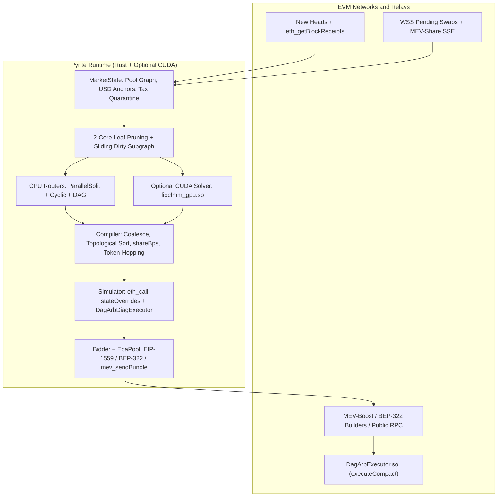

# Pyrite Architecture and Routing Reference

This document describes the state ingestion pipeline, AMM pricing math, graph routing algorithms, compact calldata encoding, simulation verifier, and known completeness bounds in Pyrite.

## 1. System overview and module map

| Module | Path | Responsibility |
| :--- | :--- | :--- |
| Runtime and CLI | [src/main.rs](../src/main.rs) | Block head loop, candidate filtering, size probing, bidding, and telemetry |
| Market state | [src/discovery.rs](../src/discovery.rs) | Pool discovery, receipt log projection, USD pricing, flash sources, quarantine |
| AMM math | [src/amm.rs](../src/amm.rs) | Off-chain quoting and mutable `ResidualPool` state across 8 protocol families |
| Router coordinator | [src/router/mod.rs](../src/router/mod.rs) | 2-core pruning, multi-router dispatch, step coalescing, `shareBps`, compact encoding |
| ParallelSplit router | [src/router/parallel.rs](../src/router/parallel.rs) | Multi-pool split allocation across pools sharing a `(base, mid)` token pair |
| Cyclic router | [src/router/cyclic.rs](../src/router/cyclic.rs) | 2-4 hop Meet-in-the-Middle cycle search and 1D golden-section input sizing |
| DAG router | [src/router/dag.rs](../src/router/dag.rs) | Feedback Arc Set orientation, topological DP, and tranche-based flow allocation |
| Optional GPU bridge | [src/router/gpu.rs](../src/router/gpu.rs) | Runtime `libloading` FFI bridge to `libcfmm_gpu.so` and compact step translation |
| MEV-Share stream | [src/mev_share.rs](../src/mev_share.rs) | Flashbots SSE hint ingestion and `mev_sendBundle` backrun construction |
| Mempool backrun | [src/mempool.rs](../src/mempool.rs) | Pending router calldata decoding, shadow state projection, and baseline checks |
| Simulator | [src/simulator.rs](../src/simulator.rs) | `eth_call` bytecode `stateOverrides` verification and zero-gas revert diagnostics |
| RPC pool | [src/rpc.rs](../src/rpc.rs) | Primary/failover read routing, Multicall3 batching, and builder fan-out |
| Executor client | [src/executor.rs](../src/executor.rs) | `EoaPool` worker rotation, EIP-1559 and legacy signing, nonce tracking |
| Offline backtester | [src/backtest.rs](../src/backtest.rs) | JSONL opportunity replay, bidding profile comparison, and A/B pruning checks |
| Chain configuration | [src/config.rs](../src/config.rs) | YAML chain templates, `pyrite.json` runtime config, and `.env` secret separation |
| Solidity executor | [contracts/src/DagArbExecutor.sol](../contracts/src/DagArbExecutor.sol) | Compact binary decoder, isolated `delta[]` ledger, flash callbacks, bribe settlement |
| CUDA CFMM solver | [cuda/cfmm_solver.cu](../cuda/cfmm_solver.cu) | `fp64` convex dual solver (Stage 1) and discrete gas-aware leg pruning (Stage 2) |

### End-to-end data flow

### Per-block execution stages and latency metrics

1. `MarketState::bootstrap` loads cached static pool metadata from `logs/pools_cache_<chain>.json`, refreshes live reserves and `slot0` ticks through batched Multicall3 requests, enumerates configured factory hub pairs, and prices hub tokens in USD.
2. On each head block, the main loop fetches block receipts via `eth_getBlockReceipts` and updates touched pool states in memory (`apply_receipts_in_place`) from `Sync` and `Swap` event logs without per-pool RPC calls.
3. Before graph search, 2-core pruning strips degree-1 non-hub leaf tokens that cannot form closed cycles while keeping newly discovered pairs inside a short grace window.
4. `solve_us` records pure graph-routing compute across `solve_all` (CPU routers and optional `libcfmm_gpu.so`). By contrast, `blk_ms` spans receipt fetch, state update, routing, concurrent `eth_call` simulations, bundle submission, and post-broadcast unknown-pool discovery.
5. Top candidates run concurrent `eth_call` simulations (including multi-scale borrow probes `[0.22x..2.05x]` or wider V3 multi-tick probes under a `16ms` straggler deadline). Passing candidates enter chain-specific bidding (`EthEip1559Atomic` or legacy BEP-322) and fan out across builders via `EoaPool`.
6. Unknown pool addresses seen in receipt logs are queued in `pending_unknowns` and probed via Multicall3 only when no live bundle was sent in the block and elapsed block time stays within `discovery_budget_ms`.

## 2. Routing algorithms

All routers read immutable `PoolState` snapshots cloned into mutable `ResidualPool` structs (`src/amm.rs`) so sequential allocations along a route reflect cumulative price impact. Each router emits `RouteCandidate` values into one ranking, deduplication, exact `U256` replay, and compact compilation pipeline (`src/router/mod.rs`).

### 2.1 ParallelSplit (`src/router/parallel.rs`)

When two or more active pools connect the same `(base_anchor, mid_token)` pair, `ParallelSplit` allocates flow across cheaper buy pools and richer sell pools:

1. Filter active pools with zero recorded simulation strikes and `cached_depth_usd >= $12`, requiring at least one pool updated within the dirty window during incremental scans.
2. Prune pairs immediately when `max(marginal_rate(base->mid)) * max(marginal_rate(mid->base)) <= 1.0002` (2 bps).
3. Step through discrete USD tranches (`[250, 75, 22, 6, 1.5, 0.4]` USD, up to 16 iterations per tranche), selecting `(buy_pool, sell_pool)` pairs with `buy_pool != sell_pool` that maximize `base_back - dx` above the 2 bps threshold and updating `ResidualPool` states in place.
4. Deduct flash-loan fees and per-leg gas estimates before emitting the combined split/merge candidate.

### 2.2 Cyclic (`src/router/cyclic.rs`)

`Cyclic` searches 2-4 hop closed loops `base -> ... -> base` with continuous 1D input sizing:

1. Build directed `(token_in, token_out)` edge buckets and retain up to 3 pools per directed pair (top 2 by marginal rate plus top 1 by USD liquidity depth).
2. Build Meet-in-the-Middle shells around `base`: 1-hop (`from_1`, `to_1`) and 2-hop (`from_2`, `to_2`) tables keeping top-2 paths per intermediate token.
3. Stitch 2-hop (`from_1 x to_1`), 3-hop (`from_1 x to_2`, `from_2 x to_1`), and 4-hop (`from_2 x to_2`) cycles while enforcing strict pool disjointness along each loop.
4. Filter raw cycles by spot-rate product (`> 1.0004`) and heuristic upper bound `min_depth * 0.35 * (spot_prod - 1)`, keeping the top candidates for continuous sizing.
5. Contract the upper bound into the feasible single-tick V3 window via binary search, then run 24 golden-section iterations (`phi = 0.618...`) to maximize exact net output after flash fees.

### 2.3 DAG (`src/router/dag.rs`)

`DAG` builds an acyclic token-flow subgraph rooted and sunk at `base` (node `0` = `START`, nodes `1..=k` = intermediate tokens, node `k+1` = `END`):

1. Score tokens within 1-2 hops of `base` using forward (`best_from_base`) and reverse (`best_to_base`) marginal rates. Retain reachable hub tokens plus top-ranked non-hub tokens up to the node budget.
2. Orient every intermediate token pair `(a, b)` unilaterally via a greedy Feedback Arc Set heuristic: compare round-trip proxies `p_ab = f_a * r_ab * t_b` and `p_ba = f_b * r_ba * t_a`, sort preferences descending by `p_ab - 0.5 * p_ba`, and insert `u -> v` only when `v` cannot already reach `u` in transitive closure `reach[][]`, followed by Kahn topological sort.
3. Reserve a non-colliding flash source (`forbidden_flash_pool`) and run a topological spot-product upper-bound check before flow allocation.
4. Allocate flow across discrete USD tranches using iterative topological longest-output dynamic programming over mutable `ResidualPool` states:
   - Each inner iteration finds the highest-output `START -> END` path for tranche `dx`, verifies pool non-reuse, checks the directed-edge budget (`<= 8` edges on CPU) and marginal per-edge gas gate, and mutates pool residuals along the committed path.
   - Repeated commits across iterations produce split branches out of `START` and merged balances at shared intermediate hub tokens.

### 2.4 Optional CUDA CFMM solver (`cuda/cfmm_solver.cu` and `src/router/gpu.rs`)

When `SOLVER_MODE` is `gpu` or `hybrid`, `src/router/gpu.rs` dynamically loads `libcfmm_gpu.so`:

1. Stage 1 solves the continuous convex CFMM dual problem in strict IEEE-754 `fp64` across multiple parallel restarts on GPU SMs.
2. Because continuous dual solutions scatter dust flows across hundreds or thousands of pools whose fixed swap gas (`52k-135k` gas/hop) turns net profit negative, Stage 2 runs GPU discrete leg pruning and parallel basin polish under `GPU_MAX_GAS_LIMIT`, enforcing `MAX_COMPACT_TOKENS = 16` and `MAX_DAG_STEPS = 32`.
3. Every GPU candidate returns to Rust for exact `U256` replay (`verify_and_refine_candidate`), flash-provider collision checks, and `eth_call` simulation.

## 3. Compilation, compact executor, and zero-gas diagnostics

### 3.1 Compiling flows into `DagStep[]` and compact calldata (`src/router/mod.rs`)

1. Coalesce identical `(pool, token_in, token_out)` flows and topologically sort intermediate tokens, rejecting any candidate whose non-base token graph contains a cycle.
2. Convert absolute flow splits out of each token into relative basis points (`shareBps` in `1..=10000`, forcing each token's final outgoing consumer to `10000` so no intermediate dust remains stranded).
3. Apply token-hopping where an intermediate token has a single UniV2 or Solidly consumer untouched by intervening steps: set the upstream producer's `recipient` directly to the consumer pool (`inputInPool = true`), saving one ERC-20 `transfer` (~30k-50k gas). When step `0` uses token-hopping or a non-callback V2 fork, flash-source selection disables inline `FLASH_V2_SWAP` to prevent dispatching `uniswapV2Call` to a DEX pool.
4. Pack token table indices into 1 byte per step `(inIdx << 4) | outIdx` (`<= 16` unique tokens per transaction) alongside `uint128` borrow and `minNetProfit` bounds for `DagArbExecutor.executeCompact`.

### 3.2 On-chain settlement (`contracts/src/DagArbExecutor.sol`)

`DagArbExecutor` compiles to `15,034 B` with Solidity `0.8.26` (`via_ir=true`, Cancun EVM, Solady `SafeTransferLib`):

- Tracks per-transaction token balances inside an isolated `uint256[16] memory delta` array backed by EIP-1153 transient storage slots (`TSLOT_DELTA_BASE = 32..47`), preventing preexisting retained profits on the contract from leaking into downstream swap legs or builder bribes.
- Supports `0%`-fee flash loans from Morpho Blue and Balancer V2 Vault (automatically switching flash providers if any swap leg touches the Balancer V2 Vault singleton), `1 bps` UniV3/PancakeV3 flash loans, and inline UniV2 flash swaps.
- Pays `block.coinbase` / builder `bribeRecipient` directly from contract native balance when `address(this).balance >= bribeWei`, falling back to `WETH.withdraw(bribeWei)` only when native reserves are insufficient.

### 3.3 Zero-gas revert diagnostics (`src/simulator.rs`)

Production `DagArbExecutor` bytecode uses bare `revert()` to minimize deployment size and runtime gas. During `eth_call` verification:

- Wrapped-native routes simulate with `bribeBps = 1` and `bribeRecipient = caller` so gas accounting captures the real `withdraw` and native transfer path, combined with exact calldata byte pricing (`21,000 + 4 * zero_bytes + 16 * nonzero_bytes`).
- When a candidate fails simulation within the per-block diagnostic budget, `src/simulator.rs` injects the companion `DagArbDiagExecutor` bytecode onto the executor address via `eth_call` `stateOverrides` and decodes structured revert payloads (`DiagFlashRepayShortfall` with `maxTaxPpm`, `DiagStepZeroReceived`, `DiagStepSwapReverted`) at zero mainnet gas cost.

## 4. AMM pricing models (`src/amm.rs`)

- `UniV2` and volatile `Solidly`: constant-product quoting `out = (gamma * dx * r_out) / (r_in + gamma * dx)` in `f64` during graph search and exact `U256` integer math during candidate refinement.
- `Solidly` stable (`x^3 * y + x * y^3 = k`): 8-iteration Newton-Raphson solver over normalized reserves.
- `UniV3`, `PancakeV3`, `InfinityCL`, and `UniV4`: concentrated-liquidity quoting via `sqrtPriceX96` and active liquidity `L`. Off-chain quotes bound swaps to the active tick interval (or a bounded constant-`L` window on deep hub-hub pools until any shortfall/revert triggers `allow_multi_tick = false`). Singleton protocols (`UniV4` `PoolManager`, `BalancerV2` `Vault`) index pools in the graph via deterministic `keccak256` virtual addresses and restore singleton target addresses plus `extraData` during step compilation.
- `BalancerV2` (`Weighted` and `ComposableStable`): invariant math incorporating non-18 `scalingFactors`, embedded BPT exclusion, and external yield `tokenRates` (`wstETH`, `rETH`).
- `MetricOmm` (PropAMM): reads `sell_price_x64`, `buy_price_x64`, `active_bin`, and pause flags via targeted `extsload` storage slots, handling unsorted `token0`/`token1` pool layouts explicitly.

## 5. Known algorithmic and runtime limitations

1. `src/amm.rs` does not yet walk multi-tick `tickBitmap` structures during off-chain V3/V4 search; deep cross-tick spreads rely on concurrent `eth_call` size-probe multipliers (`[0.22x..24.0x]`) or the multi-tick CLMM model in `cuda/`.
2. CPU `dag.rs` orients intermediate pairs unilaterally via greedy FAS proxies and allocates flow in discrete USD tranches with early `break` gates, which can miss reverse-oriented edges or smooth multi-branch splits that continuous convex optimization finds.
3. Compact 4-bit nibble packing `(inIdx << 4) | outIdx` caps unique tokens per route at `16`, even when step count scales up to `MAX_DAG_STEPS = 32`.
4. `src/rpc.rs` caps `eth_call` simulation gas at `2,400,000` (`0x249f00`), and HTTP head-block polling processes the latest block without backfilling `(last_seen_block + 1)..=bn` receipts if a poll skips intermediate blocks.
5. General multi-protocol flash-loan execution (`220k-300k+ gas`) carries higher base gas overhead than specialized pre-funded 2-hop assembly contracts (`110k-140k gas`) in public Ethereum builder auctions.
